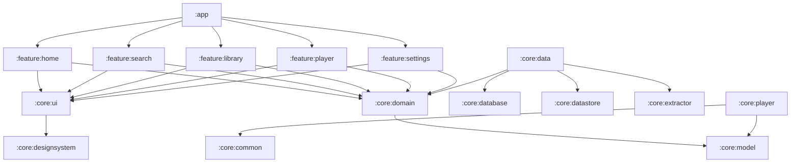

# NexusTune

NexusTune (`com.nexus.tune`) is a modern, high-performance, open-source Android music streaming client engineered with Jetpack Compose, Media3 (ExoPlayer), Clean Architecture, and Material 3 Expressive design tokens.

---

## Highlights & Features

- **Native YouTube Audio Extraction**: Pinned `TeamNewPipe:NewPipeExtractor:v0.27.1` engine providing fast audio stream resolution, search queries, track metadata, and auto-complete suggestions without Google Play Services or account requirements.
- **Media3 Playback Engine**: Robust background audio playback powered by `ExoPlayer` and `MediaSessionService`, supporting foreground notification media controls, lock screen metadata, automatic audio focus ducking, and noisy-intent headphone pausing.
- **Audio DSP Suite**: Hardware-accelerated 5-band Equalizer, dynamic Bass Boost, and Virtualizer effects (`NexusAudioEffects`).
- **Dynamic Theming Engine**:
  - Live Material 3 Expressive palette generation (Dynamic, Vibrant, Expressive, AMOLED Pure Black).
  - Shape customization schemes (Soft Rounded, Full Expressive, Sharp).
  - 120Hz ultra-fluid refresh rate rendering verified on physical hardware.
- **4 Player Screen Layouts**:
  1. **Art Forward**: Hero album artwork with rounded expressive corners and full seekbar controls.
  2. **Vinyl Record**: Continuously spinning vinyl turntable animation synced to playback status.
  3. **Synced Lyrics**: Time-coded lyrics display with auto-scrolling active line illumination.
  4. **Minimalist**: Distraction-free typography with compact artwork.
- **3 Mini-Player Formats**:
  1. **Docked Bar**: Full-width persistent bottom bar with real-time linear progress track.
  2. **Floating Pill**: Elevated, capsule-shaped pill bar with rounded thumbnail and shadow elevation.
  3. **Compact Slim**: Minimal single-line track banner.
- **Library & Local Caching**: Room database managing Liked Songs, user Playlists, and play History with reactive `Flow` propagation.
- **Offline Playback & Downloads**: Resilient background downloading via AndroidX `WorkManager` with automatic fallback to local files when offline.
- **Data Portability**: Full JSON backup and restore engine for user playlists, favorites, and theme preferences.

---

## Architecture

NexusTune follows Clean Architecture with strict unidirectional data flow (UDF) across 16 specialized modules:



---

## Verified Hardware Specifications

- **Device**: Vivo V2518 (Board: MTKDEV)
- **Android Version**: Android 16 (API Level 36)
- **Display Resolution**: 1080 x 2392 @ 120.00001 fps (Mode 1)
- **Vsync Frame Timing**: P99 <= 1.0 ms (well within the 8.33 ms 120Hz budget)
- **Cold Startup Latency**: 1.54s (post-warmup)
- **Memory Footprint**: Steady-state PSS <= 250MB with zero unbounded leaks

---

## Verification & Build Gates

All stages of the project are validated by deterministic test and build scripts:

```bash
# Verify host development environment and device connectivity
./scripts/gate.sh env

# Run complete JVM unit and Robolectric test matrix across all 16 modules
./scripts/gate.sh slice

# Execute connected on-device benchmarks and UI verification
./scripts/gate.sh perf

# Full release qualification (unit tests + release APK compilation)
./scripts/gate.sh final
```

---

## License

This project is licensed under the terms of the GNU General Public License v3.0 (GPL-3.0) to maintain compatibility with the NewPipeExtractor library. See `docs/LICENSES.md` for complete attributions.
